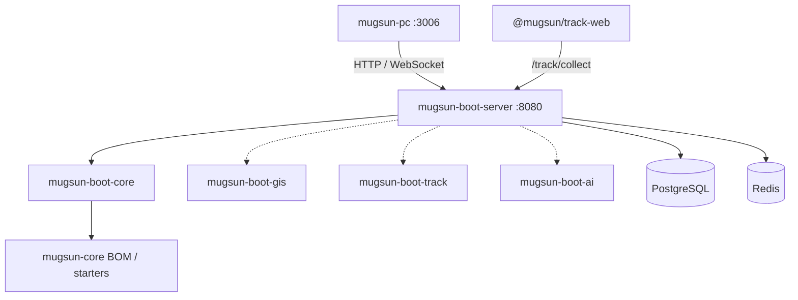

# mugsun-boot

**中文** | [English](./README_EN.md)

可私有化的中后台后端：一条 compose 起库，一个 jar 对外服务。  
系统管理与工作流打底；GIS、埋点、AI 按模块装配——数据留在你机器上，而不是又一堵功能墙。

[文档](https://docs.mugsun.com/boot/) · [快速开始](https://docs.mugsun.com/guide/getting-started) · [安全清单](https://docs.mugsun.com/boot/security-checklist)


前置：JDK 21、Maven 3.9+、Docker；与 [mugsun-core](https://github.com/mugsun/mugsun-core) **平级** clone（core 尚未发中央仓，须先本地 install）。

```bash
cd ../mugsun-core && mvn clean install -DskipTests && cd ../mugsun-boot
docker compose up -d
cp config/application-local.yml.example config/application-local.yml
mvn -pl mugsun-boot-server -am spring-boot:run
```

打开 http://localhost:8080/ping 。默认账号 **`admin` / `123456`**（`MUGSUN_INIT_PASSWORD` 可覆盖）。**生产必须改密**；`prod` 未注入初始口令时会直接拒绝启动。管理台见 [mugsun-pc](https://github.com/mugsun/mugsun-pc)（开发默认 `:3006` 代理到本服务 `:8080`）。

逐步说明与冒烟清单：[文档 · 快速开始](https://docs.mugsun.com/guide/getting-started)。

## 它解决什么

开源中后台常见两种别扭：要么首页堆满模块名，新人不知道先干什么；要么能力绑在别人的云上，私有化时处处卡壳。boot 想做的是**可带走的底座**：Postgres + Redis + 本仓可执行应用；认证、权限、租户、工作流、开放平台在 core 模块里；地理信息、行为分析、AI 以独立模块挂上，也能用 Maven profile 或环境变量裁掉。

技术基线来自当前 POM：JDK 21（虚拟线程）、Spring Boot **3.5.13**、本仓 / core **0.1.0**、MyBatis-Flex、Sa-Token、JetCache、Warm-Flow、Flyway 基线。主推 PostgreSQL 16（compose 镜像含 PostGIS + pgvector，供 GIS / AI），Redis 默认库号 `3`。

## 架构



```text
mugsun-boot/
  mugsun-boot-core/     # 认证、系统、流程、租户、开放平台…
  mugsun-boot-gis/      # 可选：图层 / 空间查询 / 矢量瓦片
  mugsun-boot-track/    # 可选：采集摄入、聚合、回放相关 API
  mugsun-boot-ai/       # 可选：模型 / 对话 / 知识库 / MCP（Spring AI）
  mugsun-boot-server/   # 装配壳；默认 profile = full
```

默认 `full` 全量装配；`-Pbasic,'!full'` 只要核心；另有 `gis-only` / `track-only` / `ai-only` 以及信创库 profile。运行时也可用 `MUGSUN_GIS_ENABLED` / `MUGSUN_TRACK_ENABLED` / `MUGSUN_AI_ENABLED=false` 关闭能力（jar 仍可能在 classpath）。说明见 [docs/可选模块装配.md](docs/可选模块装配.md)。

## 核心能力（按源码，不按海报）

系统与权限侧覆盖用户、角色、菜单、部门、数据权限、操作与登录审计；传输与审计链路含国密相关能力（上线前对照 [安全清单](https://docs.mugsun.com/boot/security-checklist)）。消息、文件存储、代码生成与在线表单、Warm-Flow 工作流、开放平台（OAuth2 + PKCE、API Key）都在 core 主线上。埋点域负责 `/track/collect`、配置下发与分析相关 API，和浏览器 SDK、pc 看板组成竖切。GIS 与 AI 是可选包，只有你启用时才应出现在对外承诺里。

PowerJob Worker **默认关闭**，需要独立 Server 并设置 `POWERJOB_ENABLED=true`。OpenAPI 在 http://localhost:8080/swagger-ui/index.html（`prod` 下关闭）。更细的接口与配置键以源码和文档为准，这里不抄功能墙。

## 和其它仓的关系

免费开源主线：`boot` · `core` · `pc` · `track`（及 [mugsun-docs](https://github.com/mugsun/mugsun-docs)）。

| 仓 | 和本仓的关系 |
| --- | --- |
| [mugsun-core](https://github.com/mugsun/mugsun-core) | BOM 与 starter；构建前必须 `mvn install` |
| [mugsun-pc](https://github.com/mugsun/mugsun-pc) | 管理端；CORS / OAuth 回跳默认 `MUGSUN_FRONT_URL=http://localhost:3006` |
| [mugsun-track](https://github.com/mugsun/mugsun-track) | 浏览器 SDK；本仓 track 模块吃采集流量 |
| cloud / uniappx-ui | **规划或商业意向**，不是本仓的已开源依赖 |

## 边界（老实说）

- **有**：可本地跑通的单体后端、可选模块裁剪、与 track/pc 打通的埋点竖切、Flyway 基线与生产口令硬门槛。
- **没有**：已开源的微服务 `cloud` 发行版；目前也**没有**公网 Demo（[说明](https://docs.mugsun.com/demo)）。
- **不是**「大而全低代码」营销页；能力以你启用的模块和当前版本源码为准。
- 演示口令只用于本地；`fronttest` 仅在显式打开 lab 开关时播种，默认关闭。

## 本地开发补充

- 工作目录必须是**本仓根目录**，以便加载 `optional:file:./config/application-local.yml`（gitignore）。示例里的 SM2 等占位用于避免每次重启密钥漂移。
- 打包：`mvn -pl mugsun-boot-server -am package -DskipTests`，产物 `mugsun-boot-server/target/mugsun-boot.jar`。
- compose：`5432` Postgres、`6379` Redis；库账号默认与开发 JDBC 一致（`mugsun` / `mugsun`）。无 Docker 时可用 `scripts/init-db.sql`。
- 配置入口与生产注入见 [配置](https://docs.mugsun.com/boot/configuration) 与仓内 `application*.yml`。

## License

[Apache-2.0](./LICENSE)
