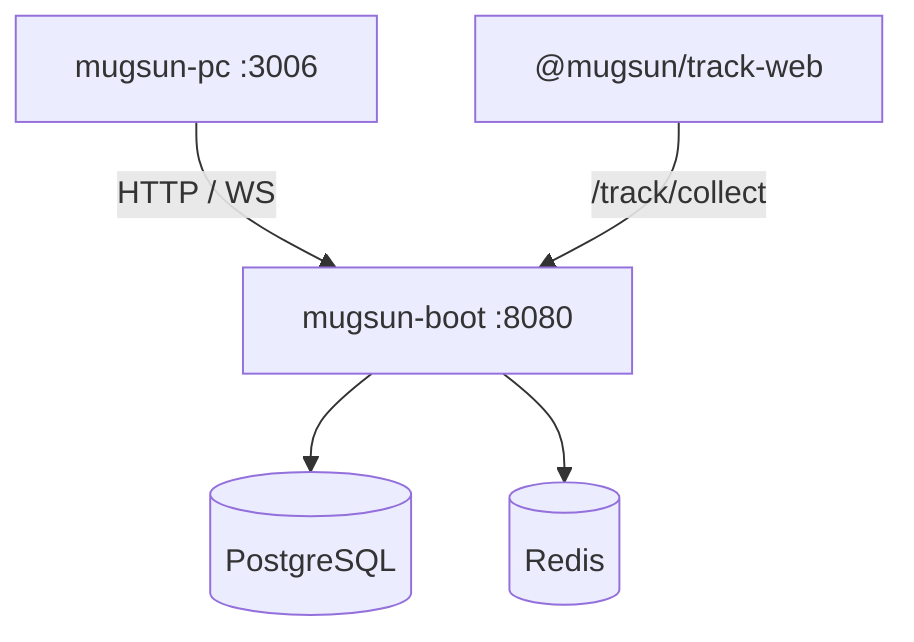

<p align="center">
  
</p>

# mugsun-boot

**中文** | [English](./README_EN.md)

**可私有化的中后台后端：一条 compose 起库，一个 jar 对外服务。**  
系统管理与工作流打底；GIS / 埋点 / AI 按需装配——不是大而全低代码墙。

[文档](https://docs.mugsun.com/boot/) · [快速开始](https://docs.mugsun.com/guide/getting-started) · [演示（即将上线）](https://docs.mugsun.com/demo)


---

## 为什么选它

常见开源后台要么功能墙吓死人，要么一绑云就走不脱。boot 想清楚三件事：

1. **带得走**：Postgres + Redis + 本仓 jar；数据与密钥在你机器上。
2. **裁得动**：默认全量（core + gis + track + ai）；`-Pbasic` 或环境变量关掉可选模块。
3. **和埋点是一条竖切**：采集在 [track SDK](https://github.com/mugsun/mugsun-track)，摄入与看板在本仓 + [pc](https://github.com/mugsun/mugsun-pc)，不是另购一套分析云。

它不是已开源的微服务发行版（cloud 仍在规划）；也不是「装上就能卖的 SaaS」。

---

## 最短路径（本地）

前置：JDK 21、Maven 3.9+、Docker；与 [mugsun-core](https://github.com/mugsun/mugsun-core) **平级** clone。

```bash
# 0. 内核（未发中央仓，须本地安装一次）
cd ../mugsun-core && mvn clean install -DskipTests && cd ../mugsun-boot

# 1. 库：Postgres 16（PostGIS + pgvector）+ Redis
docker compose up -d

# 2. 本地覆盖（gitignore；固定 SM2 等，避免每次重启密钥漂移）
cp config/application-local.yml.example config/application-local.yml

# 3. 启动（工作目录 = 本仓根目录）
mvn -pl mugsun-boot-server -am spring-boot:run
```

打开 http://localhost:8080/ping 。默认账号 **`admin` / `123456`**（可用 `MUGSUN_INIT_PASSWORD` 覆盖）。**生产必须改密**；`prod` 未注入初始口令会直接拒绝启动。

管理台见 [mugsun-pc](https://github.com/mugsun/mugsun-pc)（默认代理到 `:8080`，前端 `:3006`）。逐步说明：[文档 · 快速开始](https://docs.mugsun.com/guide/getting-started)。

---

## 它长什么样



```text
mugsun-boot/
  mugsun-boot-core/    # 认证、系统、流程、租户、开放平台…
  mugsun-boot-gis/     # 可选 GIS
  mugsun-boot-track/   # 可选埋点域
  mugsun-boot-ai/      # 可选 AI（Spring AI + pgvector）
  mugsun-boot-server/  # 装配壳（默认 profile=full）
```

> **截图占位**：Swagger / 管理台登录与系统管理截图就绪后放这里。公网 Demo 见 [演示](https://docs.mugsun.com/demo)。

模块开关与 profile 细节：[docs/可选模块装配.md](docs/可选模块装配.md)。能力清单与配置键以文档和源码为准，本页不堆功能表。

---

## 诚实边界

| 有 | 没有 / 尚未 |
| --- | --- |
| 单体可运行后端 + Flyway 基线 | 已开源的 cloud 微服务版 |
| 国密传输 / 审计相关能力（见安全清单） | 保证开箱即用的公网 Demo |
| 可选 GIS / 埋点 / AI 源码模块 | 把 uniappx-ui 当成免费依赖 |

免费开源主线：`boot` · `core` · `pc` · `track`。更多：[docs.mugsun.com](https://docs.mugsun.com/)。

---

## License

[Apache-2.0](./LICENSE)
