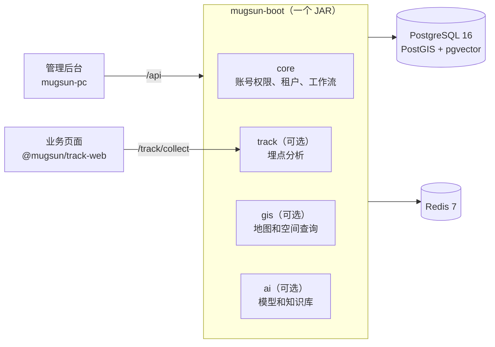

# mugsun-boot

[English](./README_EN.md) | [文档](https://docs.mugsun.com/boot/) | [更新日志](./CHANGELOG.md)

[](https://github.com/mugsun/mugsun-boot/actions/workflows/ci.yml)
[](https://github.com/mugsun/mugsun-boot/actions/workflows/compose-full.yml)
[](./LICENSE)

mugsun 的后端，一个 Spring Boot 3 单体应用。打包后是一个可执行 JAR，运行时需要 PostgreSQL 和 Redis。

它自带中后台项目常用的功能，比如账号权限、多租户和工作流。GIS、埋点分析和 AI 是三个可选模块，用不到的可以不打进包。

下图是管理后台的「埋点分析 → 数据概览」页。


## 用 Docker 试用

只需要安装 Docker（Compose v2.17+）。数据库、Redis、后端和管理后台都在容器里启动。

```bash
git clone https://github.com/mugsun/mugsun-boot.git && cd mugsun-boot
docker compose -f docker-compose.full.yml up -d --build
docker compose -f docker-compose.full.yml run --rm init show
```

最后一条命令打印管理员口令。打开 <http://127.0.0.1:8088>，用 `admin` 登录。

Compose 文件里没有默认口令。数据库口令、管理员口令和加密密钥在首次启动时随机生成，保存在 Docker 卷里。

管理后台默认只能在本机访问。要从其他机器访问，启动前设置 `MUGSUN_HTTP_BIND=0.0.0.0`。

这组命令每周在 CI 里从零执行一次，包括登录和上报第一条埋点。它只用于试用，生产环境的配置见[配置](https://docs.mugsun.com/boot/configuration)和[上线安全清单](https://docs.mugsun.com/boot/security-checklist)。

<details>
<summary>其他启动选项</summary>

| 需求 | 做法 |
| --- | --- |
| 换端口 | 启动前设置 `MUGSUN_HTTP_PORT`，默认 `8088` |
| 换时区 | 启动前设置 `MUGSUN_TZ`，默认 `Asia/Shanghai`，例如 `MUGSUN_TZ=UTC` |
| 查看登录提示 | `docker compose -f docker-compose.full.yml logs ready` |
| 清空数据重新开始 | `docker compose -f docker-compose.full.yml down -v`，数据和密钥都会删除 |
| 用本地的管理后台源码 | 平级放好 `mugsun-pc`，启动时加 `MUGSUN_PC_SRC=../mugsun-pc` |
| 固定数据库镜像版本 | 设置 `MUGSUN_PG_IMAGE=ghcr.io/mugsun/postgis-pgvector@sha256:...` |

数据库镜像默认是 `ghcr.io/mugsun/postgis-pgvector:16-3.4`，支持 amd64 和 arm64，不需要在本机构建。

</details>

## 有哪些功能

| 部分 | 内容 |
| --- | --- |
| 账号与权限 | 用户、角色和部门。菜单和按钮权限在后台配置，数据权限按角色限定能看到哪些行。 |
| 多租户 | 一个库、一套表服务多个租户，业务表按 `tenant_id` 自动隔离。 |
| 工作流 | 基于 Warm-Flow。在后台画流程，支持条件、并行和会签。 |
| 代码生成 | 把一张表变成后端代码、管理后台页面和菜单 SQL。 |
| 表单 | 拖拽设计表单，或直接对业务表做在线增删改查。 |
| 开放平台 | OAuth2（含 PKCE）和 API Key 两种接入方式。 |
| 消息与文件 | 站内信、短信和邮件。附件可以存本地、MinIO 或阿里云 OSS。 |
| 任务与日志 | 定时任务基于 PowerJob。操作日志防篡改，登录和接口访问各有日志。 |
| 安全 | 登录有[行为验证码](https://docs.mugsun.com/pc/captcha)和双因子。支持国密 SM2 和 SM4，接口可以加解密，字段可以脱敏。 |
| 埋点分析（可选） | 接收 [@mugsun/track-web](https://github.com/mugsun/mugsun-track) 上报的数据，提供看板、错误监控和会话回放。 |
| GIS（可选） | 图层、场景和空间查询，可以输出矢量瓦片。底图可以接天地图和高德等地图服务。 |
| AI（可选） | 模型接入、对话和知识库，检索使用 pgvector。另有 OpenAI 格式的对话接口。 |

每项功能的用法见[功能特性](https://docs.mugsun.com/boot/features/)。等保 2.0 三级的条款对照见 [docs/security](./docs/security/等保2.0三级条款映射.md)。

菜单、按钮和权限标识都是数据，在菜单管理页里维护。


## 本地开发

需要 JDK 21、Maven 3.9+ 和 Docker。

`main` 分支依赖 [mugsun-core](https://github.com/mugsun/mugsun-core) 的 `0.2.0-SNAPSHOT`。Maven Central 上没有这个版本，要先装到本地。

```bash
git clone https://github.com/mugsun/mugsun-core.git
cd mugsun-core && mvn -B clean install -DskipTests && cd ..

git clone https://github.com/mugsun/mugsun-boot.git && cd mugsun-boot
docker compose up -d    # PostgreSQL 5432、Redis 6379
./mvnw -pl mugsun-boot-server -am package -DskipTests
export MUGSUN_INIT_PASSWORD='<admin 的初始口令>'
java -jar mugsun-boot-server/target/mugsun-boot.jar --spring.profiles.active=dev
```

`curl http://localhost:8080/ping` 有响应就是启动成功。接口文档在 <http://localhost:8080/swagger-ui/index.html>，`prod` 配置下关闭。

`MUGSUN_INIT_PASSWORD` 只在首次建库时用来创建 `admin`。`prod` 配置下不设置它，后端会拒绝启动。

管理后台在 [mugsun-pc](https://github.com/mugsun/mugsun-pc)，执行 `pnpm dev` 后打开 <http://localhost:3006>。

构建和启动都要在仓库根目录执行，构建要带 `-am`。

不带 `-am` 时，`mugsun-boot-core` 取的是本地 Maven 仓库里的 jar，里面可能是其他分支的旧代码。

<details>
<summary>端口被占用、连不上 Redis、改数据库地址</summary>

5432 或 6379 被占用时换一个宿主机端口，后端启动时读同一组变量：

```bash
export MUGSUN_DB_PORT=55432 MUGSUN_REDIS_PORT=56379
docker compose up -d
```

用 `dev` 配置启动时如果连不上 Redis，后端会改用进程内存储并在日志里告警，仍然可以登录。

设置 `mugsun.redis.mode=redis` 可以禁止这种降级。生产环境必须有 Redis。

| 变量 | 作用 |
| --- | --- |
| `MUGSUN_DB_HOST` `MUGSUN_DB_PORT` `MUGSUN_DB_NAME` | 数据库地址 |
| `MUGSUN_DB_USERNAME` `MUGSUN_DB_PASSWORD` | 数据库账号 |
| `MUGSUN_DB_URL` | 直接给整条 JDBC 地址 |
| `MUGSUN_REDIS_HOST` `MUGSUN_REDIS_PORT` | Redis 地址，默认使用 3 号库 |
| `TRACK_JDBC_URL` | 埋点库 `mugsun_track` 的地址，默认和主库在同一台 |
| `MUGSUN_FRONT_URL` | 管理后台的地址，用于跨域和 OAuth 回跳，默认 `http://localhost:3006` |

`prod` 配置不读上面这些变量，用的是 `JDBC_URL`、`REDIS_HOST` 等，见[配置](https://docs.mugsun.com/boot/configuration)。

本地的个性化配置写在 `config/application-local.yml` 里，这个文件不进仓库。

模板是同目录下的 `application-local.yml.example`。

没有 Docker 时，可以参考 `scripts/init-db.sql` 手工建库。

</details>

## 只打包需要的模块

默认把四个模块都打进 JAR。只要其中一部分时，用 Maven Profile 选择：

```bash
./mvnw -pl mugsun-boot-server -am package -DskipTests -Pbasic,'!full'
```

| Profile | 打进 JAR 的模块 |
| --- | --- |
| `full`（默认） | core、gis、track 和 ai |
| `basic` | 只有 core |
| `gis-only` `track-only` `ai-only` | core 加一个可选模块 |
| `kingbase` `dameng` | 追加人大金仓或达梦的 JDBC 驱动 |

`basic` 和三个 `*-only` 都要同时写上 `'!full'`。

不重新打包也可以关掉模块。启动时把对应的变量设为 `false`：

| 变量 | 模块 |
| --- | --- |
| `MUGSUN_GIS_ENABLED` | GIS |
| `MUGSUN_TRACK_ENABLED` | 埋点分析 |
| `MUGSUN_AI_ENABLED` | AI |

这三个变量只接受 `true` 和 `false`。

开关的完整规则见[架构](https://docs.mugsun.com/guide/architecture)，模块的拆分方式见[可选模块的设计说明](./docs/可选模块装配.md)。

## 换数据库

默认使用 PostgreSQL 16，带 PostGIS 和 pgvector 两个扩展。表结构由 Flyway 管理，启动时自动升级。

人大金仓和达梦各有一个 Maven Profile，openGauss 有单独的建库脚本。适配范围和部署步骤见[信创国产库适配指南](./docs/信创国产库适配指南.md)。

埋点数据单独保存在 `mugsun_track` 库里，和业务库分开。

## 代码结构



| 目录 | 内容 |
| --- | --- |
| `mugsun-boot-core` | 账号权限、租户和工作流等核心功能 |
| `mugsun-boot-track` | 埋点数据的接收、聚合和回放 |
| `mugsun-boot-gis` | 图层、空间查询和矢量瓦片 |
| `mugsun-boot-ai` | 模型、对话和知识库 |
| `mugsun-boot-server` | 只负责打包，把上面的模块合成一个可执行 JAR |

数据访问用 MyBatis-Flex，鉴权用 Sa-Token，缓存用 JetCache。

AI 模块没有引入 Spring AI，模型调用和向量检索由模块自己实现。

## 目前的限制

`main` 分支的版本是 `0.2.0-SNAPSHOT`。升级前请看[更新日志](./CHANGELOG.md)和[升级指南](https://docs.mugsun.com/boot/upgrade)。

- 没有公网演示环境，按上面的命令可以在本地完整启动。
- 只有单体版本，没有微服务版本。
- 内置的 MCP Server 暂时下线，加上鉴权后恢复。`/sse` 和 `/mcp` 返回 404，`MUGSUN_AI_MCP_SERVER` 不起作用。
- 定时任务需要另外部署 PowerJob Server，并设置 `POWERJOB_ENABLED=true`。默认的 Compose 里没有它。

## 相关仓库

| 仓库 | 说明 |
| --- | --- |
| [mugsun-pc](https://github.com/mugsun/mugsun-pc) | 管理后台，菜单和按钮权限由本仓库的接口返回 |
| [mugsun-core](https://github.com/mugsun/mugsun-core) | 公共依赖，包括统一响应体、全局异常处理和接口加解密 |
| [mugsun-track](https://github.com/mugsun/mugsun-track) | 浏览器埋点 SDK，数据上报到本仓库的埋点模块 |
| [mugsun-docs](https://github.com/mugsun/mugsun-docs) | 文档站 [docs.mugsun.com](https://docs.mugsun.com/) 的源码 |

## 参与贡献

提交前请读[贡献指南](./CONTRIBUTING.md)。改表结构的做法见[迁移脚本的说明](./mugsun-boot-core/src/main/resources/db/migration/README.md)：0.2 发布前直接改基线，发布后只新增脚本，已发布的脚本不能修改。

安全问题请按 [SECURITY.md](https://github.com/mugsun/.github/blob/main/SECURITY.md) 私下报告，不要开公开 Issue。

## 许可

MIT，见 [LICENSE](./LICENSE)。第三方组件的声明见 [NOTICE](./NOTICE)。
