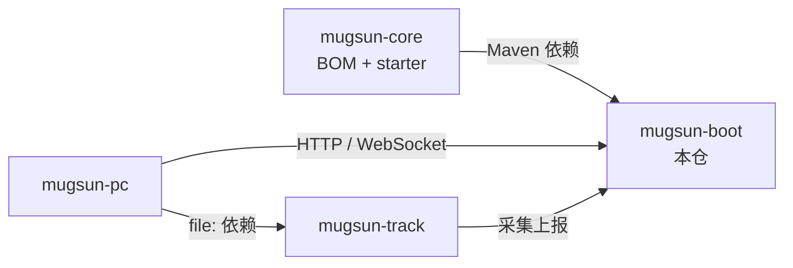

# mugsun-boot

**中文** | [English](README_EN.md)


mugsun 平台的**单体后端**：把系统管理、工作流、多租户、开放平台，以及可选的 GIS / 埋点 / AI，装进一个可执行应用。

- **适合**：需要私有化中后台底座、希望「一条 compose + 本地 jar」就能联调的团队。
- **不是**：已开源的微服务发行版（cloud 仍在规划中）；也不是必须全开 GIS/埋点/AI 的全栈套件——默认全量，可用 Maven profile 裁剪。

文档：[docs.mugsun.com](https://docs.mugsun.com/) · [Boot 章节](https://docs.mugsun.com/boot/) · [快速开始](https://docs.mugsun.com/guide/getting-started)

## 模块结构

```text
mugsun-boot/
  mugsun-boot-core/     # 认证、系统、流程、租户、开放平台等（无 GIS / 埋点 / AI 源码）
  mugsun-boot-gis/      # 可选：地理信息（JTS / PostGIS / 矢量瓦片）
  mugsun-boot-track/    # 可选：埋点分析（独立库 mugsun_track）
  mugsun-boot-ai/       # 可选：模型 / 对话 / 知识库 / MCP（Spring AI + pgvector）
  mugsun-boot-server/   # 装配壳；默认 profile=full → core+gis+track+ai
```

| Profile | 命令示例 | 说明 |
| --- | --- | --- |
| `full`（默认） | `mvn -pl mugsun-boot-server -am package -DskipTests` | core + gis + track + ai |
| `basic` | `mvn -pl mugsun-boot-server -am clean package -DskipTests -Pbasic,'!full'` | 仅核心 |
| `gis-only` / `track-only` / `ai-only` | 同上，换成对应 profile，并带 `'!full'` | 核心 + 单可选模块 |
| `kingbase` / `dameng` | 叠加 JDBC 驱动 profile | 信创库，见 `docs/信创国产库适配指南.md` |

运行时也可关模块（jar 仍在 classpath）：`MUGSUN_GIS_ENABLED` / `MUGSUN_TRACK_ENABLED` / `MUGSUN_AI_ENABLED=false`。详情见 [docs/可选模块装配.md](docs/可选模块装配.md)。

## 能力一览

以当前源码包与控制器为准（非营销清单）：

| 分组 | 内容 |
| --- | --- |
| 系统管理 | 用户 / 角色 / 菜单 / 部门 / 岗位 / 字典 / 业务字典 / 参数 / 行政区划 / 顶部菜单 |
| 权限与审计 | RBAC + 数据权限 + 接口权限；字段脱敏；数据变更 SM3 哈希链 + SM2 签名 |
| 认证 | 账号密码、短信、社交登录（JustAuth）；可选双因子（邮件/短信二次验证码）；图形验证码 |
| 消息 | 站内信、邮件模板、短信模板、通知渠道；WebSocket（默认 Redis 扇出） |
| 文件 | x-file-storage：本地 / MinIO / 阿里云 OSS；生产关闭本地匿名直出 |
| 低代码 | 代码生成、生成数据源/方案、在线表单、动态建模相关 API |
| 工作流 | Warm-Flow：流程定义、待办、运行中流程管控 |
| 任务 | PowerJob Worker（**默认关闭**，需独立 Server + `POWERJOB_ENABLED=true`） |
| 规则 | LiteFlow 编排（含租户初始化链） |
| 监控 | Actuator + Prometheus；操作 / 登录 / 访问 / 错误 / 通用日志；在线会话；缓存管理 |
| 开放平台 | OAuth2 授权码 + PKCE、API Key、HMAC 签名与调用日志 |
| 租户 | 默认共享库 `tenant_id` 字段隔离；可配独立库或独立 schema；套餐菜单收窄 |
| GIS（可选） | 图层 / 空间查询 / 分析 / 矢量瓦片 / 场景与 tileset |
| 埋点（可选） | 采集、看板分析、会话回放、sourcemap、漏斗 / 留存、可视化埋点 |
| AI（可选） | 模型与渠道、对话、知识库 / 向量库、MCP、配额与计费相关 API |

## 技术栈（版本来自 POM）

| 组件 | 版本 |
| --- | --- |
| JDK | 21（虚拟线程开启） |
| Spring Boot | 3.5.13 |
| 本仓 / mugsun-core | 0.1.0 |
| MyBatis-Flex | 1.11.8（经 mugsun-bom） |
| Sa-Token | 1.44.0 |
| JetCache | 2.7.9（本地 `linkedhashmap` + Redis Lettuce） |
| Warm-Flow | 1.8.8 |
| PowerJob | 5.1.2 |
| Spring AI（ai 模块） | 1.1.2 |
| 数据库 | PostgreSQL 16 + PostGIS + pgvector（compose 镜像） |
| 缓存 | Redis 7，默认库号 `3` |
| Schema | Flyway（`V1__baseline_0_1.sql` 基线） |

## 仓库关系

免费开源主线：`boot` · `core` · `pc` · `track`（及文档仓）。cloud / uniappx-ui 为规划或商业意向，**不要当作已开源可安装产品**。

兄弟仓需**平级 clone**（与 CI、Dockerfile 一致）：

```text
mugsun/
  mugsun-core/    # 先 mvn install
  mugsun-boot/    # 本仓
  mugsun-pc/      # 管理端（默认前端 origin :3006）
  mugsun-track/   # 埋点 SDK（可选）
```



## 快速开始

### 环境

- JDK 21+
- Maven 3.9+
- Docker（用于 compose；或本机已有 PostgreSQL 16 / Redis 7）

### 1. 基础设施

```bash
# 在本仓根目录：Postgres（容器名 mugsun-pg）+ Redis（mugsun-redis）
docker compose up -d
```

- 端口：`5432`（Postgres）、`6379`（Redis）
- 库账号：`mugsun` / `mugsun`（与 `application.yml` 默认 JDBC 一致）
- 库：`mugsun`（主库）、`mugsun_track`（埋点；仅 core 时可省略）
- 镜像含 **PostGIS + pgvector**（GIS / AI 需要）；超级用户默认 `postgres` / `postgres`，可用 `MUGSUN_POSTGRES_SUPER_PASSWORD`、`MUGSUN_DB_PASSWORD` 覆盖

无 Docker 时：`psql -U postgres -f scripts/init-db.sql`。

### 2. 安装内核

```bash
cd ../mugsun-core && mvn clean install -DskipTests && cd ../mugsun-boot
```

`mugsun-starter-*` 未发中央仓库，boot 构建前必须本地 install core。

### 3. 本地覆盖（建议）

```bash
cp config/application-local.yml.example config/application-local.yml
```

该文件已被 gitignore。从本仓根目录启动时会 `optional:file:./config/application-local.yml`，用于固定 SM2 密钥、回显验证码等。SM2 密钥留空则每次启动临时生成，登录易不稳定。

### 4. 启动

```bash
# 工作目录必须是本仓根目录（以便加载 ./config/application-local.yml）
mvn -pl mugsun-boot-server -am spring-boot:run
```

或打包后：

```bash
mvn -pl mugsun-boot-server -am package -DskipTests
java -jar mugsun-boot-server/target/mugsun-boot.jar
```

- HTTP：**http://localhost:8080**
- 探活：`GET /ping`
- OpenAPI：http://localhost:8080/swagger-ui/index.html（`prod` profile 下关闭）
- 管理端 CORS / OAuth 回跳默认 `MUGSUN_FRONT_URL=http://localhost:3006`

首次启动 Flyway 执行基线，并幂等播种超级管理员。

### 5. 默认账号

| 项 | 值 |
| --- | --- |
| 用户名 | `admin`（`UserConstants.ADMIN_USERNAME`） |
| 初始口令 | `123456`（`mugsun.security.init-password`，可用环境变量 `MUGSUN_INIT_PASSWORD` 覆盖） |

**生产必须改密**：`prod` profile 下未注入 `MUGSUN_INIT_PASSWORD` / `mugsun.security.init-password` 时，`InitPasswordHardeningGuard` 会直接拒绝启动。联调账号 `fronttest` 仅在 `mugsun.lab.seed-fronttest=true` 时播种，默认关闭。

### 6. 管理端

见 [mugsun-pc](https://github.com/mugsun/mugsun-pc)。按文档站 [快速开始](https://docs.mugsun.com/guide/getting-started) 平级 clone 后对接本服务。

## 配置要点

| 配置 / 环境变量 | 默认（开发） | 说明 |
| --- | --- | --- |
| `server.port` | `8080` | HTTP 端口 |
| JDBC | `jdbc:postgresql://localhost:5432/mugsun` · `mugsun`/`mugsun` | prod 用 `JDBC_URL` 等注入 |
| Redis | `localhost:6379`，database `3` | prod 用 `REDIS_*` |
| `mugsun.web.front-url` | `http://localhost:3006` | `MUGSUN_FRONT_URL` |
| `mugsun.crypto.*` | 本地 example 有占位 | prod：`strict-keys=true`，密钥缺失拒启 |
| `POWERJOB_ENABLED` | `false` | Worker；Server 默认 `127.0.0.1:7700` |
| Track JDBC | `jdbc:postgresql://localhost:5432/mugsun_track` | `TRACK_JDBC_*` |

生产：`--spring.profiles.active=prod`，见 `application-prod.yml`（数据源、Redis、SMTP、短信、存储、前端 URL 全部环境变量注入）。

## 测试

```bash
# CI 等价：先 install core，再
mvn -B verify
```

仓库内约 60 个 `*Test.java`（含集成测试与模块测试）。CI 使用服务容器 Postgres + Redis（`MUGSUN_TEST_USE_SERVICES=true`）；本地也可走 Testcontainers。

## 相关链接

| 资源 | 地址 |
| --- | --- |
| 文档站 | https://docs.mugsun.com/ |
| Boot 文档 | https://docs.mugsun.com/boot/ |
| 内核 | https://github.com/mugsun/mugsun-core |
| 管理端 | https://github.com/mugsun/mugsun-pc |
| 埋点 SDK | https://github.com/mugsun/mugsun-track |
| 官网 | https://mugsun.com |
| 提交规范 | [.github/COMMIT_CONVENTION.md](.github/COMMIT_CONVENTION.md) |

## 许可证

[Apache License 2.0](LICENSE)
