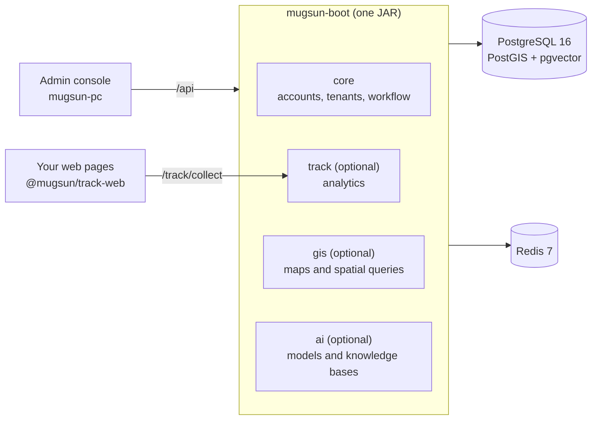

# mugsun-boot

[中文](./README.md) | [Docs](https://docs.mugsun.com/en/boot/) | [Changelog](./CHANGELOG.md)

[](https://github.com/mugsun/mugsun-boot/actions/workflows/ci.yml)
[](https://github.com/mugsun/mugsun-boot/actions/workflows/compose-full.yml)
[](./LICENSE)

The backend of mugsun: a Spring Boot 4 monolith that builds into a single executable JAR. It needs PostgreSQL and Redis at runtime.

It ships with what most admin systems need, such as accounts and permissions, multi-tenancy and workflow. GIS, product analytics and AI are three optional modules that you can leave out of the build.

The screenshot below is the Tracking > Overview page of the admin console.


## Try it with Docker

All you need is Docker (Compose v2.17+). The database, Redis, the backend and the admin console all run in containers.

```bash
git clone https://github.com/mugsun/mugsun-boot.git && cd mugsun-boot
docker compose -f docker-compose.full.yml up -d --build
docker compose -f docker-compose.full.yml run --rm init show
```

The last command prints the admin password. Open <http://127.0.0.1:8088> and sign in as `admin`.

The Compose file contains no default passwords. The database password, the admin password and the encryption keys are generated on first start and kept in Docker volumes.

The admin console listens on localhost only. To reach it from another machine, set `MUGSUN_HTTP_BIND=0.0.0.0` before starting.

CI runs these commands from scratch every week, including the sign-in and the first tracked event. The setup is meant for evaluation. For production, see [Configuration](https://docs.mugsun.com/en/boot/configuration) and the [security checklist](https://docs.mugsun.com/en/boot/security-checklist).

<details>
<summary>More startup options</summary>

| To | Do this |
| --- | --- |
| Change the port | Set `MUGSUN_HTTP_PORT` before starting (default `8088`) |
| Change the time zone | Set `MUGSUN_TZ` before starting (default `Asia/Shanghai`), for example `MUGSUN_TZ=UTC` |
| Change the subnet | Set `MUGSUN_NET_PREFIX` to the first three octets before starting (default `172.30.88`), for example `MUGSUN_NET_PREFIX=10.88.0`. If the stack already exists, run `down` (without `-v`) first, then start it again |
| See the sign-in hint | `docker compose -f docker-compose.full.yml logs ready` |
| Start over with empty data | `docker compose -f docker-compose.full.yml down -v`, which deletes data and keys |
| Build the admin console from local source | Put `mugsun-pc` next to this repository and start with `MUGSUN_PC_SRC=../mugsun-pc` |
| Pin the database image | Set `MUGSUN_PG_IMAGE=ghcr.io/mugsun/postgis-pgvector@sha256:...` |

The default database image is `ghcr.io/mugsun/postgis-pgvector:16-3.4`, built for amd64 and arm64. You don't have to build it locally.

</details>

## What's inside

| Area | What you get |
| --- | --- |
| Accounts and permissions | Users, roles and departments. Menu and button permissions are configured in the console, and data scopes limit which rows a role can see. |
| Multi-tenancy | One database and one set of tables serve many tenants. Business tables are isolated by `tenant_id` automatically. |
| Workflow | Built on Warm-Flow. You draw flows in the console, with conditions, parallel branches and countersigning. |
| Code generation | Turns a table into backend code, admin console pages and menu SQL. |
| Forms | Design a form by drag and drop, or run CRUD on a business table directly. |
| Open platform | Two ways in: OAuth2 (with PKCE) and API keys. |
| Messages and files | In-app messages, SMS and email. Attachments go to local disk, MinIO or Alibaba Cloud OSS. |
| Jobs and logs | Scheduled jobs run on PowerJob. The operation log is tamper-evident, and sign-ins and API calls have their own logs. |
| Security | Sign-in has a [behavioural captcha](https://docs.mugsun.com/en/pc/captcha) and two-factor authentication. SM2 and SM4 are supported, APIs can be encrypted and fields can be masked. |
| Analytics (optional) | Receives data from [@mugsun/track-web](https://github.com/mugsun/mugsun-track) and serves dashboards, error monitoring and session replay. |
| GIS (optional) | Layers, scenes and spatial queries, with vector tile output. Basemaps can come from Tianditu, Amap and similar services. |
| AI (optional) | Model access, chat and knowledge bases, with retrieval on pgvector. There is also an OpenAI-style chat endpoint. |

Each feature has its own page under [Features](https://docs.mugsun.com/en/boot/features/). A mapping to the MLPS 2.0 Level 3 requirements is in [docs/security](./docs/security/等保2.0三级条款映射.md) (in Chinese).

## Local development

You need JDK 21, Maven 3.9+ and Docker.

The `main` branch depends on [mugsun-core](https://github.com/mugsun/mugsun-core) `0.3.0-SNAPSHOT`. That version is not on Maven Central, so install it locally first.

```bash
git clone https://github.com/mugsun/mugsun-core.git
cd mugsun-core && mvn -B clean install -DskipTests && cd ..

git clone https://github.com/mugsun/mugsun-boot.git && cd mugsun-boot
docker compose up -d    # PostgreSQL on 5432, Redis on 6379
./mvnw -pl mugsun-boot-server -am package -DskipTests
export MUGSUN_INIT_PASSWORD='<initial password for admin>'
java -jar mugsun-boot-server/target/mugsun-boot.jar --spring.profiles.active=dev
```

The backend is up when `curl http://localhost:8080/ping` answers. API docs are at <http://localhost:8080/swagger-ui/index.html>; they are turned off under the `prod` profile.

`MUGSUN_INIT_PASSWORD` is only used to create `admin` when the database is first initialised. Under the `prod` profile the backend refuses to start without it.

The admin console lives in [mugsun-pc](https://github.com/mugsun/mugsun-pc). Run `pnpm dev` there and open <http://localhost:3006>.

Build and run from the repository root, and keep `-am` in the build command.

Without `-am`, `mugsun-boot-core` comes from the jar in your local Maven repository, which may hold stale code from another branch.

<details>
<summary>Ports in use, no Redis, a different database address</summary>

If 5432 or 6379 is taken, pick other host ports. The backend reads the same variables at startup:

```bash
export MUGSUN_DB_PORT=55432 MUGSUN_REDIS_PORT=56379
docker compose up -d
```

With the `dev` profile, a backend that cannot reach Redis falls back to in-process storage and logs a warning; you can still sign in.

Set `mugsun.redis.mode=redis` to forbid the fallback. Production must have Redis.

| Variable | Purpose |
| --- | --- |
| `MUGSUN_DB_HOST` `MUGSUN_DB_PORT` `MUGSUN_DB_NAME` | Database address |
| `MUGSUN_DB_USERNAME` `MUGSUN_DB_PASSWORD` | Database account |
| `MUGSUN_DB_URL` | A full JDBC URL instead of the parts above |
| `MUGSUN_REDIS_HOST` `MUGSUN_REDIS_PORT` | Redis address; database 3 is used by default |
| `TRACK_JDBC_URL` | Address of the analytics database `mugsun_track`; defaults to the same host as the main database |
| `MUGSUN_FRONT_URL` | Address of the admin console, used for CORS and OAuth redirects; defaults to `http://localhost:3006` |

The `prod` profile does not read these variables. It uses `JDBC_URL`, `REDIS_HOST` and others, described in [Configuration](https://docs.mugsun.com/en/boot/configuration).

Put machine-specific settings in `config/application-local.yml`. The file is ignored by git.

The template is `application-local.yml.example` in the same directory.

Without Docker, use `scripts/init-db.sql` as a reference to create the databases by hand.

</details>

## Build only the modules you need

All four modules go into the JAR by default. Use a Maven profile to pick a subset:

```bash
./mvnw -pl mugsun-boot-server -am package -DskipTests -Pbasic,'!full'
```

| Profile | Modules in the JAR |
| --- | --- |
| `full` (default) | core, gis, track and ai |
| `basic` | core only |
| `gis-only` `track-only` `ai-only` | core plus one optional module |
| `kingbase` `dameng` | Adds the JDBC driver for KingbaseES or Dameng |

`basic` and the three `*-only` profiles must be combined with `'!full'`.

You can also switch a module off without rebuilding. Set its variable to `false` at startup:

| Variable | Module |
| --- | --- |
| `MUGSUN_GIS_ENABLED` | GIS |
| `MUGSUN_TRACK_ENABLED` | Analytics |
| `MUGSUN_AI_ENABLED` | AI |

These three variables accept only `true` and `false`.

The full rules for these switches are in [Architecture](https://docs.mugsun.com/en/guide/architecture). How the modules are split is described in the [module design notes](./docs/可选模块装配.md) (in Chinese).

## Other databases

The default is PostgreSQL 16 with the PostGIS and pgvector extensions. Flyway manages the schema and upgrades it at startup.

KingbaseES and Dameng each have a Maven profile, and openGauss has its own set of scripts. Coverage and deployment steps are in the [domestic database guide](./docs/信创国产库适配指南.md) (in Chinese).

Analytics data lives in a separate database, `mugsun_track`, apart from the business data.

## Layout



| Directory | Contents |
| --- | --- |
| `mugsun-boot-core` | Core features such as accounts, permissions, tenants and workflow |
| `mugsun-boot-track` | Ingestion, aggregation and replay of analytics data |
| `mugsun-boot-gis` | Layers, spatial queries and vector tiles |
| `mugsun-boot-ai` | Models, chat and knowledge bases |
| `mugsun-boot-server` | Packaging only; it assembles the modules above into one executable JAR |

Data access uses MyBatis-Flex, authentication uses Sa-Token and caching uses JetCache.

The AI module does not pull in Spring AI; it makes model calls and vector searches itself.

## Current limits

The `main` branch is at `0.2.0-SNAPSHOT`. Read the [changelog](./CHANGELOG.md) and the [upgrade guide](https://docs.mugsun.com/en/boot/upgrade) before upgrading.

- There is no public demo. The commands above give you a complete local setup.
- Only the monolith exists. There is no microservice edition.
- The built-in MCP server is offline until authentication is added. Meanwhile `/sse` and `/mcp` return 404, and `MUGSUN_AI_MCP_SERVER` has no effect.
- Scheduled jobs need a PowerJob server that you deploy yourself, plus `POWERJOB_ENABLED=true`. The default Compose files do not include it.

## Related repositories

| Repository | What it is |
| --- | --- |
| [mugsun-pc](https://github.com/mugsun/mugsun-pc) | The admin console. Its menus and button permissions come from this backend |
| [mugsun-core](https://github.com/mugsun/mugsun-core) | Shared dependencies: the response envelope, global exception handling and API encryption |
| [mugsun-track](https://github.com/mugsun/mugsun-track) | The browser tracking SDK. It reports to the analytics module here |
| [mugsun-docs](https://github.com/mugsun/mugsun-docs) | Source of the documentation site, [docs.mugsun.com](https://docs.mugsun.com/en/) |

## Contributing

Read the [contributing guide](https://github.com/mugsun/.github/blob/main/CONTRIBUTING_EN.md) before you send a change. For schema changes, follow the [migration notes](./mugsun-boot-core/src/main/resources/db/migration/README.md) (in Chinese): until 0.2 is released, edit the baseline script directly; after the release, add new scripts only. Released scripts must not be edited.

Report security issues privately as described in [SECURITY.md](https://github.com/mugsun/.github/blob/main/SECURITY.md). Please do not open a public issue.

## License

MIT, see [LICENSE](./LICENSE). Third-party notices are in [NOTICE](./NOTICE).
