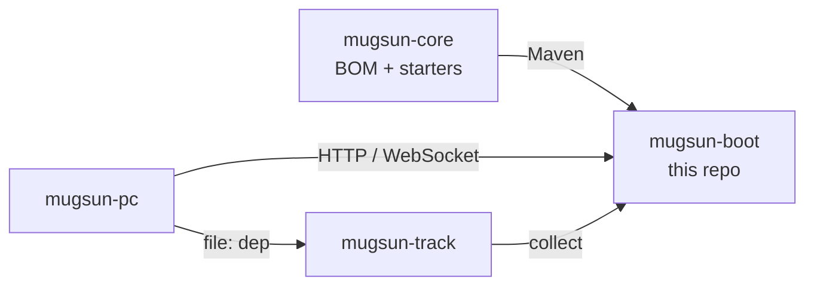

# mugsun-boot

[中文](README.md) | **English**


The **monolithic backend** of the mugsun platform: system administration, workflow, multi-tenancy, an open platform, plus optional GIS, product analytics (track), and AI — in one executable.

- **For** teams that want a privatizable mid-/back-office base and a local path of “compose + jar”.
- **Not** an open-source microservice distribution (cloud is planned). Optional GIS / track / AI are on by default (`full`) and can be trimmed with Maven profiles.

Docs: [docs.mugsun.com](https://docs.mugsun.com/) · [Boot](https://docs.mugsun.com/boot/) · [Getting started](https://docs.mugsun.com/guide/getting-started)

## Modules

```text
mugsun-boot/
  mugsun-boot-core/     # Auth, system, flow, tenant, open platform (no GIS/track/AI sources)
  mugsun-boot-gis/      # Optional: GIS (JTS / PostGIS / vector tiles)
  mugsun-boot-track/    # Optional: analytics (separate DB mugsun_track)
  mugsun-boot-ai/       # Optional: models / chat / knowledge / MCP (Spring AI + pgvector)
  mugsun-boot-server/   # Assembly shell; default profile=full → core+gis+track+ai
```

| Profile | Example | Meaning |
| --- | --- | --- |
| `full` (default) | `mvn -pl mugsun-boot-server -am package -DskipTests` | core + gis + track + ai |
| `basic` | `mvn -pl mugsun-boot-server -am clean package -DskipTests -Pbasic,'!full'` | core only |
| `gis-only` / `track-only` / `ai-only` | same pattern with `'!full'` | core + one optional module |
| `kingbase` / `dameng` | JDBC driver profiles | domestic DBs; see `docs/信创国产库适配指南.md` |

Runtime toggles (jar still on classpath): `MUGSUN_GIS_ENABLED` / `MUGSUN_TRACK_ENABLED` / `MUGSUN_AI_ENABLED=false`. See [docs/可选模块装配.md](docs/可选模块装配.md).

## Features (from source)

| Area | Capabilities |
| --- | --- |
| System admin | Users, roles, menus, depts, posts, dicts, biz dicts, params, regions, top menus |
| AuthZ & audit | RBAC, data scope, API scope; field masking; change audit (SM3 chain + SM2 sign) |
| AuthN | Password, SMS, social (JustAuth); optional 2FA (email/SMS code); captcha |
| Messaging | In-app, mail/SMS templates, notify channels; WebSocket (Redis fan-out by default) |
| Files | x-file-storage: local / MinIO / Aliyun OSS; prod disables anonymous local `/file/**` |
| Low-code | Codegen, gen datasources/schemes, online forms, modeling APIs |
| Workflow | Warm-Flow: definitions, todos, running-instance controls |
| Jobs | PowerJob worker (**off by default**; needs Server + `POWERJOB_ENABLED=true`) |
| Rules | LiteFlow (incl. tenant init chain) |
| Ops | Actuator + Prometheus; op/login/access/error/usual logs; sessions; cache admin |
| Open platform | OAuth2 auth-code + PKCE, API keys, HMAC signing, call logs |
| Tenancy | Shared DB + `tenant_id` by default; optional dedicated DB or schema; package menus |
| GIS (optional) | Layers, spatial query/analysis, vector tiles, scenes/tilesets |
| Track (optional) | Collect, dashboards, replay, sourcemap, funnel/retention, visual tracking |
| AI (optional) | Models/channels, chat, knowledge/vector store, MCP, quota/billing APIs |

## Stack (from POMs)

| Component | Version |
| --- | --- |
| JDK | 21 (virtual threads enabled) |
| Spring Boot | 3.5.13 |
| This repo / mugsun-core | 0.1.0 |
| MyBatis-Flex | 1.11.8 (via mugsun-bom) |
| Sa-Token | 1.44.0 |
| JetCache | 2.7.9 (local `linkedhashmap` + Redis Lettuce) |
| Warm-Flow | 1.8.8 |
| PowerJob | 5.1.2 |
| Spring AI (ai module) | 1.1.2 |
| Database | PostgreSQL 16 + PostGIS + pgvector (compose image) |
| Cache | Redis 7, database index `3` |
| Schema | Flyway (`V1__baseline_0_1.sql`) |

## Sibling repositories

Free OSS line: `boot` · `core` · `pc` · `track` (and docs). cloud / uniappx-ui are planned or commercial — **not** shipped as open installable products here.

Clone **side by side** (matches CI and Dockerfile):

```text
mugsun/
  mugsun-core/    # mvn install first
  mugsun-boot/    # this repo
  mugsun-pc/      # admin UI (default origin :3006)
  mugsun-track/   # analytics SDK (optional)
```



## Quick start

### Prerequisites

- JDK 21+
- Maven 3.9+
- Docker (or local PostgreSQL 16 / Redis 7)

### 1. Infrastructure

```bash
docker compose up -d
```

- Ports: `5432` (Postgres), `6379` (Redis)
- DB user: `mugsun` / `mugsun` (matches default JDBC)
- Databases: `mugsun`, `mugsun_track` (skip track DB for core-only builds)
- Image includes **PostGIS + pgvector**; override with `MUGSUN_POSTGRES_SUPER_PASSWORD`, `MUGSUN_DB_PASSWORD`

Without Docker: `psql -U postgres -f scripts/init-db.sql`.

### 2. Install core

```bash
cd ../mugsun-core && mvn clean install -DskipTests && cd ../mugsun-boot
```

Starters are not on Maven Central; boot requires a local core install.

### 3. Local overrides (recommended)

```bash
cp config/application-local.yml.example config/application-local.yml
```

Gitignored. Imported as `optional:file:./config/application-local.yml` when the working directory is the repo root. Leave SM2 keys empty and a fresh keypair is generated each boot (login becomes flaky).

### 4. Run

```bash
mvn -pl mugsun-boot-server -am spring-boot:run
```

Or:

```bash
mvn -pl mugsun-boot-server -am package -DskipTests
java -jar mugsun-boot-server/target/mugsun-boot.jar
```

- HTTP: **http://localhost:8080**
- Health: `GET /ping`
- OpenAPI: http://localhost:8080/swagger-ui/index.html (disabled on `prod`)
- Front default: `MUGSUN_FRONT_URL=http://localhost:3006`

First boot runs Flyway baseline and seeds the super admin idempotently.

### 5. Default credentials

| | |
| --- | --- |
| Username | `admin` |
| Initial password | `123456` (`mugsun.security.init-password`, overridable via `MUGSUN_INIT_PASSWORD`) |

**Change this in production.** On `prod`, missing `MUGSUN_INIT_PASSWORD` / `mugsun.security.init-password` fails fast (`InitPasswordHardeningGuard`). `fronttest` is seeded only when `mugsun.lab.seed-fronttest=true` (off by default).

### 6. Admin UI

See [mugsun-pc](https://github.com/mugsun/mugsun-pc) and [Getting started](https://docs.mugsun.com/guide/getting-started).

## Configuration highlights

| Setting / env | Dev default | Notes |
| --- | --- | --- |
| `server.port` | `8080` | HTTP |
| JDBC | `jdbc:postgresql://localhost:5432/mugsun` · `mugsun`/`mugsun` | prod: `JDBC_*` |
| Redis | `localhost:6379`, db `3` | prod: `REDIS_*` |
| `mugsun.web.front-url` | `http://localhost:3006` | `MUGSUN_FRONT_URL` |
| `mugsun.crypto.*` | placeholders in local example | prod: `strict-keys=true` |
| `POWERJOB_ENABLED` | `false` | Worker; Server `127.0.0.1:7700` |
| Track JDBC | `.../mugsun_track` | `TRACK_JDBC_*` |

Production: `--spring.profiles.active=prod` → `application-prod.yml`.

## Tests

```bash
mvn -B verify
```

~60 `*Test.java` files. CI uses service containers (`MUGSUN_TEST_USE_SERVICES=true`); local runs can use Testcontainers.

## Links

| | |
| --- | --- |
| Docs | https://docs.mugsun.com/ |
| Boot docs | https://docs.mugsun.com/boot/ |
| Core | https://github.com/mugsun/mugsun-core |
| Admin UI | https://github.com/mugsun/mugsun-pc |
| Track SDK | https://github.com/mugsun/mugsun-track |
| Site | https://mugsun.com |
| Commits | [.github/COMMIT_CONVENTION.md](.github/COMMIT_CONVENTION.md) |

## License

[Apache License 2.0](LICENSE)
