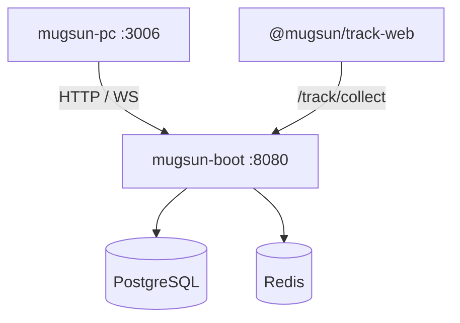

<p align="center">
  
</p>

# mugsun-boot

[简体中文](./README.md) | English

**A privatizable mid-office backend: compose for data stores, one jar for the API.**  
RBAC and workflow as the base; GIS / analytics / AI as optional modules — not a low-code feature wall.

[Docs](https://docs.mugsun.com/en/boot/) · [Getting started](https://docs.mugsun.com/en/guide/getting-started) · [Demo (coming soon)](https://docs.mugsun.com/en/demo)


---

## Why this

1. **You keep the data** — Postgres + Redis + this jar on your machines.
2. **You can slim it** — default `full` profile; `-Pbasic` or env flags drop GIS / track / AI.
3. **Analytics is a vertical slice** with [mugsun-track](https://github.com/mugsun/mugsun-track) and [mugsun-pc](https://github.com/mugsun/mugsun-pc), not a separate SaaS bill.

Not an open-sourced microservice distribution yet (`cloud` is planned). Not a hosted SaaS.

---

## Shortest local path

Needs JDK 21, Maven 3.9+, Docker; clone [mugsun-core](https://github.com/mugsun/mugsun-core) as a sibling.

```bash
cd ../mugsun-core && mvn clean install -DskipTests && cd ../mugsun-boot
docker compose up -d
cp config/application-local.yml.example config/application-local.yml
mvn -pl mugsun-boot-server -am spring-boot:run
```

Probe http://localhost:8080/ping. Default login **`admin` / `123456`** (`MUGSUN_INIT_PASSWORD` overrides). **Change it for production** — `prod` refuses to boot without an injected init password.

Admin UI: [mugsun-pc](https://github.com/mugsun/mugsun-pc). Full walkthrough: [docs](https://docs.mugsun.com/en/guide/getting-started).

---

## Shape



> **Screenshot placeholder** — Swagger / admin shots go here when ready. See [Demo](https://docs.mugsun.com/en/demo).

Module profiles: [docs/可选模块装配.md](docs/可选模块装配.md) (Chinese). This README does not duplicate a feature wall.

---

## Honest boundaries

Free OSS line: `boot` · `core` · `pc` · `track`. No public demo yet; no open `cloud` release; uniappx-ui is not a free dependency.

## License

[Apache-2.0](./LICENSE)
